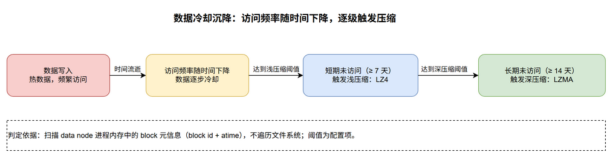
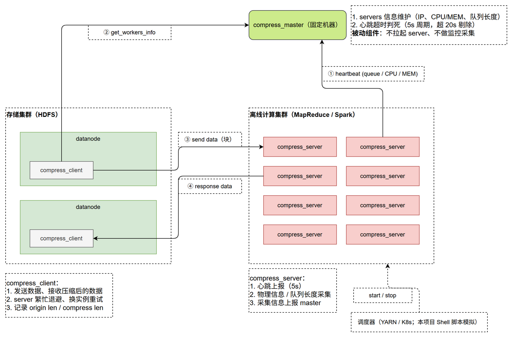
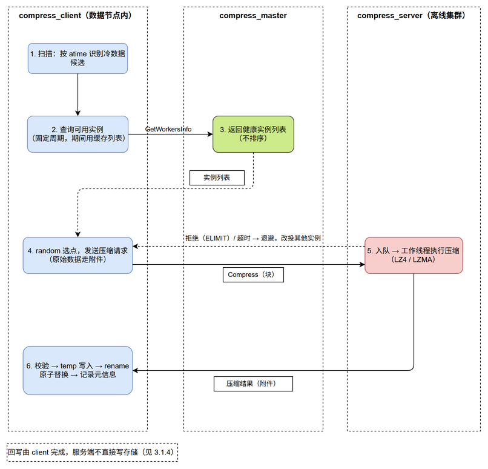
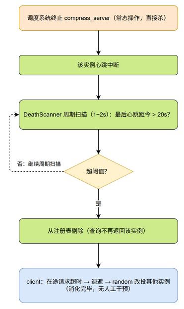

# 分布式压缩系统 设计文档

## 1. 需求背景

### 1.1 背景

本系统面向分布式存储集群中的**冷数据存储成本**问题。

存储集群（典型形态为 HDFS 类分布式文件系统）中，存在大量依据法规要求必须长期留存、但实际极少被访问的数据，主要包括：

- 医疗影像数据：法规要求保存不少于 30 年，写入后不允许改动；
- 互联网访问日志（搜索记录、访问 IP、页面停留时长等）：法规要求保存不少于 5 年；
- 其他审计类日志：仅在特定司法或监管程序下调取，常规情况下不读取。

上述数据的共同特征是：**写入后基本不再被读取，但占用大量存储空间**。

### 1.2 问题

存储成本与数据增长直接相关。未经压缩的文本类数据，其空间占用量与实际信息量严重不匹配。以线上观测数据为例，文本类访问日志的压缩比通常可达十倍以上（如 1 MB 数据压缩后约 100 KB）。若不压缩，1 PB 的存储需求经压缩后可能降至 10 GB 量级，成本差异显著。

直接对存储节点执行压缩存在困难：数据节点承载的数据量极大（单节点磁盘容量可达 16 TB 量级），自身 CPU 资源紧张，无法承担额外的压缩计算负载。

### 1.3 解决思路

在既有分布式存储集群与既有离线计算集群之间，引入一套**闲时压缩服务**：

1. 由存储集群中的数据节点侧组件识别长期未访问的冷数据；
2. 将数据发送至部署在离线计算集群上的压缩服务执行压缩；
3. 压缩结果回写存储集群，替换原始数据。

选择离线计算集群作为算力来源，是因为此类批处理集群存在明显的**忙时与闲时**（由调度系统统一管理作业与资源）：忙时作业排满，闲时可释放大量 CPU 与内存资源。利用闲时算力执行压缩，可在不新增硬件投入的前提下降低存储成本。

数据并非写入后即冷却：其访问频率随时间逐步下降，依据最后访问时间（atime）依次达到浅压缩与深压缩阈值，这个冷却沉降过程见图 1。



系统整体拓扑见图 2。



### 1.4 业务流程中各环节及其对系统的需求

| 环节 | 业务动作 | 对系统的需求 |
|---|---|---|
| 数据写入 | 业务数据写入存储集群 | 系统不介入写入路径 |
| 数据冷却 | 数据访问频率随时间下降 | 系统需能判定数据是否已进入冷态；判定依据为数据节点所在文件系统自带的 atime（最后访问时间） |
| 浅压缩 | 数据**短期未访问**，达到浅压缩阈值 | 使用高速压缩算法，对数据节点与网络影响可控 |
| 深压缩 | 数据**长期未访问**，达到深压缩阈值 | 使用高压缩比算法，允许较长耗时，可利用闲时算力 |
| 数据读取 | 业务读取已压缩数据 | 解压必须由存储侧完成，**对上层用户透明**，不额外占用用户侧资源 |

### 1.5 系统前提

本系统的需求建立在以下既有系统之上，且不改变这些既有系统的既有行为：

| 既有系统 | 对本系统的作用 | 交互方式 |
|---|---|---|
| 存储集群（HDFS 类） | 承载数据本体 | 读写数据 |
| 离线计算集群（由调度系统管理） | 提供闲时算力 | 无接口调用；本系统进程与批处理作业共享同一集群资源 |
| 调度器（YARN / K8s / 自研） | 决定压缩服务进程的启停 | 由调度器主动管理，本系统不干预其决策。本地环境以 Shell 脚本模拟启停（见 3.4.2） |

> 上述系统的内部实现均不在本系统职责范围内，本地开发环境下以简化替代实现（mock）形式提供。本系统自身的模块划分见第 3 章。

### 1.6 关键约束

1. **解压透明性**：解压操作必须在数据节点侧完成，不得占用上层用户资源。
2. **压缩元信息**：压缩操作必须记录足以支撑解压的元信息（原始长度、压缩后长度、压缩单位等），否则数据无法还原。
3. **服务端无状态**：`compress_server` 随时可能被调度器终止，其设计不得依赖进程内持久状态。
4. **控制面与数据面分离**：元信息交互与数据本体传输使用不同通道，数据本体不经过 `compress_master`。

---

## 2. 名词术语

| 术语 | 说明 |
|---|---|
| **数据节点 / datanode** | 存储集群中实际持有数据的节点。`compress_client` 以动态库形式嵌入该节点进程。 |
| **xtime** | 数据的最后访问时间，用于判定数据是否进入冷态。数据来源为文件系统自带的 atime（XFS/ext4 等本地文件系统均自动维护），block 元数据中记录 block id 与 xtime，`compress_client` 直接读取，不做额外记录。**扫描约束**：扫描对象是 **data node 进程内存中**的 block 元信息，**不遍历文件系统**（文件系统扫描开销过大）。 |
| **浅压缩** | 对达到浅压缩阈值（7 天未访问）的数据执行的压缩，采用 LZ4 算法。 |
| **深压缩** | 对达到深压缩阈值（14 天未访问）的数据执行的压缩，采用 LZMA 算法。 |
| **注册** | `compress_server` 启动时向 `compress_master` 声明自身标识与地址的一次性动作。 |
| **心跳** | `compress_server` 周期性向 `compress_master` 上报存活状态与当前负载的动作。 |
| **判死** | `compress_master` 依据最后一次心跳距今的时间间隔判定某 `compress_server` 已失效；**阈值按心跳周期倍数设定**（当前 = 心跳间隔 5s × 4 = 20s）。 |
| **反压（backpressure）** | `compress_server` 在队列深度或并发数达到上限时，向调用方返回拒绝信号，促使其改投其他服务实例。 |
| **退避（backoff）** | 客户端在请求失败或遭拒绝后，延迟一段时间再发起重试的策略。 |
| **附件（attachment）** | RPC 框架提供的传输机制，用于承载不经过消息结构体序列化的大块数据。本系统中压缩数据本体以此方式传输。 |
| **压缩元信息** | 描述一次压缩结果的信息集合，至少包含原始长度、压缩后长度、压缩单位与所用算法标识。存储位置为与压缩数据同址的文件头（见第 7 章）。 |
| **算法标记** | 压缩元信息中的字段，用于标识数据当前所处的状态（未压缩 / LZ4 / LZMA）。该字段是解压的前提。 |
| **字典（dictionary）** | 压缩算法在编码时可回溯的历史数据窗口。窗口内保存的是**原始数据**，并非压缩结果。 |
| **压缩预设（preset）** | LZMA 算法的参数组合，决定字典大小、匹配策略与内存占用。 |

---

## 3. 功能模块详细说明

### 模块划分

本系统由以下模块构成：

| 模块 | 形态 | 性质 |
|---|---|---|
| `compress_client` | 动态库 | 生产模块 |
| `compress_master` | 独立进程 | 生产模块 |
| `compress_server` | 独立进程 | 生产模块 |
| `mock_datanode` | 独立进程 | 开发辅助，不随系统交付 |
| 调度模拟脚本 | Shell 脚本 | 开发辅助，不随系统交付（见 3.4.2） |

### 3.1 compress_client

#### 3.1.1 功能概述

以动态库形式嵌入数据节点进程，负责：

1. 识别满足压缩条件的数据；
2. 读取待压缩数据，向 `compress_server` 发起压缩请求；
3. 接收压缩结果，回写并替换原始数据；
4. 在数据被读取时执行解压。

该模块**不独立部署**，无独立进程与监听端口，运行于宿主进程的地址空间内。

#### 3.1.2 输入 / 输出数据

| 类别 | 内容 |
|---|---|
| 输入 | data node 进程内存中的 block 元信息清单（block id + 最后访问时间）；待压缩数据内容；压缩结果（含压缩后数据与压缩元信息）；读取请求 |
| 输出 | 压缩请求（数据内容作为 RPC 附件）；回写后的压缩数据与元信息；解压后的原始数据 |

#### 3.1.3 流程设计

**扫描流程：**

1. 按固定周期（可配置，默认 1 分钟）扫描本节点数据——**扫描对象为 data node 进程内存中的 block 元信息（block id + atime），不遍历文件系统**（文件系统扫描开销过大）；
2. 计算距最后一次访问的时间间隔；
3. 间隔达到浅压缩阈值且未压缩的，标记为浅压缩候选；
4. 间隔达到深压缩阈值且当前为浅压缩状态的，标记为深压缩候选；
5. 将候选任务提交至内部任务队列。

判定依据为文件系统 atime，无需业务侧访问日志或独立时间戳服务。

**压缩流程：**

1. 从任务队列取出任务；若为深压缩任务，先在本节点将浅压缩块解压为原始数据（LZ4 输出不可再压）。解压位置采用**数据节点本地解压**为主方案：实现路径与原系统一致，且单块解压峰值内存约 8MB 可控。演进方向：若存储集群单机盘位数持续增多导致本地磁盘读带宽成为瓶颈，可将"读原始块→远端解压"作为替代路径，本设计在压缩任务结构上不排斥该演进（解压与压缩本就分属两个阶段）；
2. 从内存缓存的实例列表中随机选定目标实例（列表由**独立的列表同步线程**按固定周期向 `compress_master` 拉取并存于内存；压缩线程不得为每个块单独请求 master）；
3. 发起压缩请求——RPC 发出后**阻塞等待响应**，结果由响应带回，而非服务端主动推送；
4. 接收压缩结果（服务端无条件返回，含膨胀结果）——**每收齐一个切片，先与内存版本号比对一次**（版本号机制见 3.1.4）：版本已变说明期间被前台读取，立即终止任务、丢弃全部已收切片并清理 temp；
5. 校验后写入 temp 目录；**rename 替换前将 temp 文件整文件读回、校验无损，并二次校验版本号（期间被读则放弃回写）**，通过后以 rename 原子替换原文件（压缩元信息文件头自包含于压缩态文件，见 7.1）；
6. 若请求失败或遭到拒绝，执行退避后重新随机选点重试。

**解压流程：**

1. 接收上层读取请求；
2. 判断目标数据是否处于压缩状态；
2. 判断目标数据是否处于压缩状态（读文件头魔数，见 7.1）；**命中块的同时将其内存版本号 +1**，触发在途压缩任务取消（见 3.1.4）；
4. 若无压缩，直接返回。

#### 3.1.4 可靠性设计

| 关注点 | 设计 |
|---|---|
| 故障隔离 | 本模块运行于宿主进程内，任何未捕获异常可能导致宿主进程终止，因此全部对外接口必须捕获异常并以返回值表达错误，不得向宿主抛出。 |
| 资源占用 | 扫描线程与压缩工作线程数量可配置；解压并发需受控，避免并发读取时内存占用累积。 |
| 重试粒度 | 原始数据仅读取一次并保留于内存，RPC 重试复用该缓冲区，**不得在重试时重新读取数据**（否则可能在数据已被压缩的状态下再次压缩）。 |
| 压缩中途被读 | 压缩执行期间目标数据被前台读取的，**任务应取消**，已压完未回写的垃圾数据（temp 文件）必须清理。**版本号机制**：client 内存维护 block → version 映射（BlockMetaView）；Read 命中块即 version+1——与 atime 刷新同一时机：atime 管「下轮扫描不再选中」（被动防重选），版本号管「在途任务立刻止损」（主动取消）；压缩线程每收齐一个切片比对一次版本号，变化即终止任务、丢弃全部已收切片、删除 temp、记日志——server 无状态不参与取消，client 停发后续切片即可；全部收齐后回写前二次校验，通过才 rename。同一机制顺带覆盖块被删除场景。 |
| 写回一致性 | 原子替换方案：压缩数据先写入同一文件系统的 temp 目录，完成后以 rename 原子替换原文件——rename 在同一文件系统上具备原子性，不存在"写了一半"的中间状态，client 无需依赖存储侧版本机制；并发期间数据被修改的场景由"读入时快照 + 失败即整文件弃用"消化，不产生部分写入。rename 前须以压缩形式整文件读回校验（见 3.1.3）。另有配套要求：datanode 启动时须扫描清理 temp 目录中残留的垃圾文件（进程曾被杀时留下的未完成副本）。 |
| 版本与符号 | 动态库需提供版本标识，供宿主校验；导出符号应受控，避免与宿主符号冲突。 |

#### 3.1.5 单机流控

compress_client 所在的 datanode 节点同时承载前台数据读写业务，压缩流量不得挤占其网络带宽与磁盘 IO 配额。本模块采用**令牌桶**进行单机限速：系统按固定速率向有容量上限的令牌桶注入令牌，数据发送与磁盘写入前须先取得令牌，桶空则等待；桶内存量令牌允许短时突发，长期平均速率被注入速率约束。

| 参数 | 值 | 说明 |
|---|---|---|
| 注入周期 | 10ms 滑动窗口 | 长期平均速率的约束基准 |
| 窗口额度 | 100MB | 按 10Gb 网卡折算（约 1.25GB/s × 0.01s） |
| 桶容量 | 待实测标定 | 决定允许的突发规模，依赖真实盘型与负载 |
| 限流对象 | RPC 发送流量、本机磁盘读写 | 双目的：防带宽吃满 + 防 HDD 随机 IO 打爆（HDD 顺序 ~100+MB/s，随机仅 ~140 IOPS） |

本节为设计要求，实现为可选项；若实现，桶容量等参数参照 §5.6 的模式联调期实测标定。

### 3.2 compress_master

#### 3.2.1 功能概述

作为控制面中心，负责：

1. 维护 `compress_server` 注册信息；
2. 接收并更新各实例的心跳与负载状态；
3. 判定失效实例并从可用列表中移除；
4. 响应 `compress_client` 的查询请求，提供可用实例信息。

职能边界：master 是**被动**组件——只做心跳接收、查询响应与注册表维护，**不主动申请调度系统拉起 server**，不承担监控采集与告警（生产环境中监控由专门团队/系统——时序库 + 消息队列 + Grafana——承担，本系统仅经心跳上报负载字段）。

部署于固定节点，长期运行，**不承担数据本体传输**。

#### 3.2.2 输入 / 输出数据

| 类别 | 内容 |
|---|---|
| 输入 | `compress_server` 的注册与心跳上报（标识、地址、CPU、内存、队列长度）；`compress_client` 的实例查询请求 |
| 输出 | 可用实例列表（全量健康实例，含地址与负载信息，不排序） |

#### 3.2.3 流程设计

**实例维护流程：**

1. 接收注册或心跳，更新对应实例记录（地址、负载指标、最后心跳时间）；
2. 对超时未上报的实例，判定为失效并从可用列表移除；
3. 实例重新启动后按新实例重新注册。

关键参数与机制：

- **心跳间隔 5s，判死阈值 = 心跳间隔 × 4 = 20s**：判死阈值按**心跳周期倍数**设定（当前 4 倍，容忍偶发丢失与网络抖动；倍数与间隔均为配置项，不取与心跳无关的固定时间）；
- **判死 = 周期扫描**：master 本地遍历注册表时间戳（周期 1~2s，不发 RPC），扫描周期远小于判死阈值；失效实例由扫描线程直接从注册表移除——查询路径**原样返回当前注册表，不做二次过滤**；
- **注册与首次心跳合并**：实例启动后立即上报一次心跳即完成注册，不等周期到点；
- **注册表不持久化**：master 重启后注册表为空，依赖各实例下一次心跳（≤5s）自动重建；HA 不实现（生产环境的 HA 方案为 Raft 多副本选主，本项目不实现，属学习延伸项）。

**查询响应流程：**

1. 接收查询请求；
2. 返回当前注册表全部实例的完整列表（含地址与负载信息；失效剔除由判死扫描线程负责，此处不重复过滤）。

选点决策：**选点 = random**。master 只提供总表、不排序不指定；client 在列表中随机挑选目标实例，遭队列满拒绝后退避重选其他实例。理由：生产规模为几百至上千台，负载视图天然滞后，随机 + 运行时拒绝已能自然分散压力。负载字段（队列/CPU/内存）仍在心跳中上报并随列表下发，为未来策略演进保留。

#### 3.2.4 可靠性设计

| 关注点 | 设计 |
|---|---|
| 控制面不可用 | 客户端以缓存列表继续处理已识别任务，缓存过期后暂停新增任务，避免请求失效地址；master 恢复后由下次同步自动恢复。 |
| 状态恢复 | 若注册信息不持久化，进程重启后依赖各实例下一次心跳重新完成注册。 |
| 判死准确性 | 超时阈值需显著大于心跳间隔，以容忍网络抖动与调度延迟；同时需注意存活但无响应的实例会被误判。 |
| 负载视图时效性 | 客户端缓存导致其视图存在滞后，实际选点需配合运行时的拒绝与重试机制收敛。 |

> 控制面不实现高可用：本项目为单实例运行，master 重启后依赖实例心跳自动重建注册表，分钟级不可用由客户端缓存与暂停新增任务消化。

### 3.3 compress_server

#### 3.3.1 功能概述

执行实际压缩计算，部署于离线计算集群，由调度系统按资源状况动态启停。

负责：

1. 启动后采集自身负载并向 `compress_master` 注册；
2. 周期性上报心跳与负载；
3. 接收压缩请求，执行压缩并返回结果；
4. 在并发达到上限时拒绝新请求。

该模块**不读写存储系统**，不持有压缩数据的持久状态。

#### 3.3.2 输入 / 输出数据

| 类别 | 内容 |
|---|---|
| 输入 | 压缩请求（数据内容作为 RPC 附件；请求头含数据长度、压缩级别等） |
| 输出 | 压缩结果（压缩后数据作为 RPC 附件；响应头含压缩后长度、状态）；心跳上报内容 |

#### 3.3.3 流程设计

**启动流程：**

1. 进程启动，初始化 RPC 服务；
2. 采集本机 CPU、内存使用率与当前队列长度；
3. 向 `compress_master` 完成注册；
4. 启动心跳上报循环。

**压缩流程：**

1. 接收请求，并入队；
2. 工作线程取出任务，按请求中的压缩级别选择算法执行压缩；
3. **无条件返回压缩结果**——无论压缩后变大变小（不可压缩数据可能膨胀），结果都作为附件返回；是否采用由客户端依据整块压缩率决策（见 5.4），服务端不做收益校验、不拒绝；
4. 将压缩结果作为附件返回。

**终止流程：**

1. 收到终止信号；
2. 停止接受新请求；
3. **终止当前在途任务**，并向 client 反馈失败（client 侧超时/失败后退避改投其他实例）；
4. 退出。

被强制终止是**常态路径**而非异常：调度系统回收资源时直接杀死实例（进程/容器级），不保证优雅退出。在途任务的正确性由客户端侧消化——请求超时后退避改投其他实例重试（见 4.4、5.3），服务端不承担在途任务恢复。优雅退出流程保留为尽力而为的优化路径。

**并发控制：**

1. 设置方法级最大并发数；
2. 超出上限时直接返回拒绝错误，而非排队等待；
3. 客户端收到拒绝后改投其他实例。

#### 3.3.4 可靠性设计

| 关注点 | 设计 |
|---|---|
| 无状态设计 | 模块不持有持久状态，任意时刻被终止不产生数据不一致；被终止时的在途任务由客户端重试消化。 |
| 资源约束 | 压缩内存占用与所选预设相关，深压缩并发数需按单实例内存占用核算总预算；**压缩输出 buffer 按原始数据大小的 2 倍申请**——不可压缩数据（如已压缩格式）经压缩会膨胀，按 1 倍申请会越界崩溃。 |
| 优雅退出 | 退出时先停止接受新请求，再终止当前在途任务并反馈失败（client 退避重试消化），不留无响应请求。 |
| 启动自注册 | 进程启动后无条件重新注册，不依赖任何本地持久化信息。 |

### 3.4 开发辅助模块

以下模块仅用于本地开发与验证，不属于生产系统组成部分。

#### 3.4.1 mock_datanode

**功能概述**：模拟数据节点进程，作为 `compress_client` 动态库的宿主。

**输入 / 输出**：输入为本地目录中的模拟数据；输出为经 `compress_client` 处理后的压缩数据。

**流程设计**：加载 `compress_client` 动态库，提供数据读取、写入与列表遍历能力，启动后由库内部线程驱动压缩流程。

**可靠性设计**：作为测试宿主，满足流程验证即可，不要求高可用。

#### 3.4.2 调度模拟脚本

**功能概述**：模拟调度器对 `compress_server` 进程的启停，验证服务实例动态变化场景。形态为 **Shell 脚本**而非独立进程。

**输入 / 输出**：无输入接口；输出为被拉起/终止的 `compress_server` 进程。

**流程设计**：脚本按定时策略运行——周期性拉起一个 `compress_server` 实例（模拟扩容），并按另一周期终止一个实例（模拟闲时回收），从而持续制造注册、心跳、判死与客户端重试路径的演练场景。

**可靠性设计**：作为测试工具，需支持确定性复现异常场景，例如在压缩执行过程中终止实例。

---

## 4. 流程详细说明

### 4.1 系统启动流程

| 顺序 | 参与方 | 动作 |
|---|---|---|
| 1 | 调度系统 | 依据资源状况启动 `compress_server` 实例 |
| 2 | `compress_server` | 采集本机负载，向 `compress_master` 注册 |
| 3 | `compress_master` | 登记实例信息 |
| 4 | `compress_server` | 进入周期心跳循环 |
| 5 | 数据节点 | 宿主进程加载 `compress_client` 动态库 |

`compress_master` 需先于其他组件可用。

### 4.2 压缩主流程

压缩主流程见图 3。



| 步骤 | 说明 |
|---|---|
| 1 | 客户端按周期扫描，依据最后访问时间筛选候选数据 |
| 2 | 客户端的**列表同步线程**按固定周期向 master 查询可用实例并存入内存缓存，压缩线程直接使用缓存（不得每块请求 master） |
| 3 | 客户端从缓存列表 random 选定目标实例，发起 RPC 压缩请求（原始数据走附件，发出后**阻塞等待响应**，非服务端推送） |
| 4 | 服务端入队，由工作线程执行压缩（无条件返回结果，不校验收益） |
| 5 | 服务端将压缩结果作为附件经 RPC 响应返回 |
| 6 | 客户端校验（含 rename 前整文件读回）后回写，替换原始数据并记录元信息 |

压缩后数据由**客户端**回写，服务端不直接写入存储系统。回写采用 temp 目录写入 + rename 原子替换（见 3.1.4），替换动作本身原子，无需存储侧版本机制。

### 4.3 读取与解压流程

| 步骤 | 说明 |
|---|---|
| 1 | 上层发起数据读取 |
| 2 | 数据节点侧判断数据是否处于压缩状态 |
| 3 | 若已压缩，由 `compress_client` 在本地解压 |
| 4 | 返回原始数据 |

解压全程在数据节点侧完成，上层无需感知。该设计的目的在于避免用户侧承担额外的 CPU 开销。

### 4.4 实例终止与失效判定流程

| 步骤 | 参与方 | 动作 |
|---|---|---|
| 1 | 调度系统 | 终止 `compress_server` 实例 |
| 2 | `compress_master` | 心跳中断超过阈值，判定实例失效，从可用列表移除 |
| 3 | `compress_client` | 若对已失效实例的在途请求超时，执行退避后改投其他实例 |

实例失效判定流程见图 4。



### 4.5 负载反馈流程

| 步骤 | 参与方 | 动作 |
|---|---|---|
| 1 | `compress_server` | 队列深度或并发数达到上限，拒绝新请求 |
| 2 | `compress_client` | 收到拒绝信号，执行退避 |
| 3 | `compress_client` | 改投其他实例重试 |

该机制用于弥补客户端实例列表的时效性缺陷：客户端与 master 的同步存在周期，期间实例负载可能已发生变化。

---

## 5. 异常处理

### 5.1 异常分类

| 类别 | 典型情形 |
|---|---|
| 输入异常 | 数据不可读、数据为空、数据长度超出处理上限 |
| 网络异常 | 连接失败、连接中断、请求超时 |
| 节点异常 | 服务实例被终止、服务实例无响应 |
| 控制面异常 | master 不可达、注册信息过期 |
| 数据异常 | 数据不可压缩、压缩结果校验失败、并发写入冲突 |

### 5.2 处理机制

| 异常情形 | 处理机制 |
|---|---|
| 连接失败 | 改投其他可用实例 |
| 请求超时 | 本次尝试失败，数据未被修改，可退避后重试；服务端可能已完成计算，产生一次重复计算开销，不影响数据正确性 |
| 服务端拒绝（并发超限） | 明确未执行，可安全改投其他实例 |
| 服务端退出中 | 明确未执行，可安全改投其他实例 |
| 服务实例被终止 | 对客户端表现为请求超时/失败，退避后改投其他实例 |
| master 不可达 | 使用本地缓存的实例列表继续工作，缓存失效后暂停新增压缩任务 |
| 压缩收益不足（不可压/膨胀） | 由客户端按**整块**压缩率决策：低于阈值（可配，默认节省率不足 10%）则放弃本次压缩，丢弃结果、原始数据保持不动（见 5.4） |
| 压缩结果校验失败 | 丢弃本次结果，重试或跳过该数据 |
| 写回失败 / 超时 | rename 原子替换保证不存在部分写入：替换未执行则原数据完好，可安全重试整个写回；替换已执行则数据已是压缩态，重试检测到状态已变更后跳过 |
| 并发写入冲突 | 放弃本次压缩任务，留待下一轮扫描处理 |

### 5.3 幂等性与重试

压缩计算本身具备幂等性：相同输入与相同压缩级别产生相同输出，且服务端不产生持久副作用。因此**重试压缩请求不会导致数据错误**，代价仅为重复计算。

需要区分的是：**压缩 RPC 无副作用，写回存储有副作用**。重试的风险集中在写回环节，而非压缩请求本身。

工程实现上须满足以下约束：

- **原始数据仅读取一次**：重试时复用内存缓冲区，不得重新读取数据；
- **写回与压缩分别重试**：不得因写回失败而重新执行压缩；
- **退避为必需项**：避免对同一实例连续重试造成堆积。

### 5.4 不可压缩数据的处理

压缩算法对不可压缩数据（如已压缩格式）可能产生膨胀。处理原则：

- **决策单位为整个压缩单元（整块）**：不能一部分块压缩、一部分块不压——混合存储将使解压无法解析；要么整块全压，要么整块不压；
- **server 无条件返回结果**：服务端不校验收益、不拒绝，膨胀结果照样返回（见 3.3.3）；
- **client 侧收益校验**：块内按 4MB 切片传输压缩，但只在收齐全部切片后按**整块**节省率决策一次——低于阈值（可配，默认节省率不足 10%）则放弃本次压缩：丢弃全部压缩产物，**原始块文件保持不动、不写任何文件头**（无头即未压缩，读取路径天然兼容）；达到阈值才回写压缩态。

整个文件统一记录一个算法标记（见 7.1），解压据此选择解压器。

### 5.5 错误码定义

RPC 层错误码沿用框架定义：

| 错误码 | 含义 | 是否可重试 |
|---|---|---|
| `ELIMIT` | 服务端并发超限，请求未执行 | 可重试，改投其他实例 |
| `ELOGOFF` | 服务端正在退出，请求未执行 | 可重试，改投其他实例 |
| `ERPCTIMEDOUT` | 请求超时，本次尝试失败（数据未被修改） | 可退避后重试 |
| 连接类错误 | 连接失败或中断，大概率未执行 | 可重试 |

业务层错误码：

| 错误码 | 含义 |
|---|---|
| 数据不可读 | 源数据读取失败 |
| 数据为空 | 源数据长度为零 |
| 数据超限 | 数据长度超出配置上限——按块压缩后单个压缩单元大小固定（见 6.1.4），超限场景为块级校验问题 |
| 压缩失败 | 压缩算法执行失败 |
| 压缩收益不足 | 客户端按整块压缩率决策放弃压缩，原始数据未改动（client 侧日志原因，非 RPC 错误） |

### 5.6 超时设置

RPC 超时不得采用默认值。深压缩的耗时与数据量成正比，按压缩速度 1 MB/s 估算，100 MB 数据需约 100 秒，远超默认超时设置。超时需依据数据量与压缩级别动态设定，并计入排队等待时间；具体数值待联调环境实测标定。

---

## 6. 接口定义

### 6.1 内部接口

本系统内部接口采用 RPC 形式，接口描述使用 Protobuf **proto3** 语法定义。控制类消息经消息结构体传输，数据本体经 RPC 附件传输。

所有请求/响应消息通过统一的 `MsgHeader` 传递元信息，必含 `version`（接口协议版本，用于兼容性演进）与 `trace_id`（链路追踪标识）。proto3 无必填校验，关键必填字段（如 `header`、`server_id`）由服务端入口自查，缺失即拒绝请求。

```protobuf
syntax = "proto3";

message MsgHeader {
    uint32 version  = 1;    // 接口协议版本
    string trace_id = 2;    // 全链路追踪标识
}
```

#### 6.1.1 客户端向 master 查询可用实例

```protobuf
message WorkersInfoRequest {
    MsgHeader header = 1;
    string client_id = 2;
}

message WorkerInfo {
    string server_id   = 1;
    string ip          = 2;
    int32  port        = 3;
    uint32 cpu_percent = 4;
    uint32 mem_percent = 5;
    uint32 queue_len   = 6;    // 负载字段保留：策略演进备用，当前选点不使用
    int64  last_hb_ms  = 7;
}

message WorkersInfoResponse {
    MsgHeader header = 1;
    repeated WorkerInfo workers = 2;
}

service MasterService {
    rpc GetWorkersInfo(WorkersInfoRequest) returns (WorkersInfoResponse);
}
```

> 选点说明：master 返回全量健康列表，client 随机自选；负载字段仅为策略演进保留。

#### 6.1.2 服务实例向 master 上报心跳

```protobuf
message HeartbeatRequest {
    MsgHeader header = 1;
    string server_id   = 2;
    int32  port        = 3;
    uint32 cpu_percent = 4;
    uint32 mem_percent = 5;
    uint32 queue_len   = 6;
}

message HeartbeatResponse {
    MsgHeader header      = 1;
    bool  accepted        = 2;
    int32 beat_interval_ms = 3;
}

service RegistryService {
    rpc Heartbeat(HeartbeatRequest) returns (HeartbeatResponse);
}
```

> 注册说明：实例启动后立即发送本次心跳即完成注册；master 侧未见过的 `server_id` 视为注册。

#### 6.1.3 客户端向服务实例发起压缩

```protobuf
enum CompressLevel {
    SHALLOW = 0;    // 浅压缩，LZ4
    DEEP    = 1;    // 深压缩，LZMA
}

enum CompressResult {
    OK     = 0;    // 压缩成功（无条件返回，含膨胀结果；收益校验在 client 侧，见 5.4）
    FAILED = 1;    // 压缩执行失败
}
// 注：并发超限拒绝由 RPC 层 ELIMIT 表达（见 5.5），不进业务枚举；
// 「收益为负不压」是 client 侧整块决策，server 不感知（见 5.4）。

message CompressRequest {
    MsgHeader     header     = 1;
    string        data_id    = 2;
    uint64        origin_len = 3;
    CompressLevel level      = 4;
    uint64        version    = 5;    // 写回并发保护预留（rename 原子替换为主）
    // version 字段留作后续演进
    // 原始数据经 RPC 附件传输
}

message CompressResponse {
    MsgHeader      header         = 1;
    CompressResult result         = 2;
    uint64         compressed_len = 3;
    string         err_msg        = 4;
    // 压缩后数据经 RPC 附件传输
}

service CompressService {
    rpc Compress(CompressRequest) returns (CompressResponse);
}
```

#### 6.1.4 压缩单位与切片

压缩单位：**块（block）而非完整文件**。存储集群中文件本就按块分布存储，压缩以块为独立单元执行；深压缩时先在数据节点将浅压缩块解压回原始数据，再对原始数据执行 LZMA（LZ4 输出再经 LZMA 无压缩收益）。深压解压位置以数据节点本地解压为主方案；远端解压仅作为盘位扩展后的演进方向，不进入本期实现。

单个块若超出单次 RPC 附件上限，传输与压缩时进一步按固定大小切分为**切片**（slice），切片大小取 **4MB**（每 GB 仅 256 条元信息条目，头+条目合计不超一页（4KB 预算，见 7.1）；4MB 远大于 LZ4 的 64KB 回溯窗口，压缩率损失可忽略；代价仅为单切片解压峰值内存约 8MB，对 datanode 宿主可接受）。切片大小的下限受压缩算法回溯窗口约束：LZ4 的窗口固定为 64 KB，切片过小将显著降低压缩率。

### 6.2 外部接口

本系统不对外提供业务网络接口。`compress_client` 以动态库形式嵌入宿主进程，对宿主暴露 **C++ 接口**（宿主假设为类 HDFS 的 C++ 系统，同语言无 ABI 不稳定问题，见 ADR-0005）。对外接口收敛为「一个类 + 一个配置结构体 + 一个错误码枚举」，宿主唯一可见头文件 `include/compress_client/client.h`（Pimpl 隐藏内部类型）。

#### 6.2.1 接口定义

```cpp
namespace compress::client {

enum class CompressErr { kOk = 0, kInvalidArg, kWrongState, kIo,
                         kBufSmall, kBusy, /* …§5.5 体系… */ };

struct Options {                  // 全部可配置项；数值默认值占位、联调标定（§5.6）
    std::string data_dir;
    std::string master_addr = "127.0.0.1:8001";
    int scan_interval_sec = 30;
    double min_saving_ratio = 0.10;      // 整块节省率阈值，低于则放弃压缩（见 5.4）
    /* …其余数值占位、联调标定… */
};

class Client {
public:
    static Result Create(const Options& opts, std::unique_ptr<Client>* out); // 只装配，不起线程
    CompressErr Start();              // 幂等
    CompressErr Read(const std::string& path, uint64_t offset,
                     void* buf, size_t cap, size_t* out_len);  // 同步、可多线程并发
    void Shutdown() noexcept;         // 幂等
    ~Client();                        // 未 Shutdown 则自动兜底（RAII）
};

const char* Version() noexcept;       // 宿主启动时校验兼容性
}
```

| 接口 | 语义 |
|---|---|
| Create | 构造客户端对象，只装配、不起线程；配置经 `Options` 值注入 |
| Start | 启动自治线程（扫描/压缩/列表同步）；幂等 |
| Read | 透明读取：未压缩直接读；压缩文件按条目定位切片、解压后填充。缓冲不足时 `*out_len` 带回所需容量返回 `kBufSmall`，宿主扩容重调；语义对齐 POSIX `pread`，多线程可并发 |
| Shutdown | 排空在途任务、join 全部库内线程、释放；幂等，返回后可析构 |

#### 6.2.2 错误码与取舍原则

| 错误码 | 含义 | 宿主应对 |
|---|---|---|
| `kOk` | 成功 | — |
| `kInvalidArg` | 参数非法 | 修调用方 |
| `kWrongState` | 调用顺序错（未 Start 就 Read） | 修调用方 |
| `kIo` | 本地文件系统错误 | 记日志/告警 |
| `kBufSmall` | 缓冲不足，`*out_len` 已带回所需大小 | 扩容重调一次 |
| `kBusy` | 解压通道饱和 | 稍后重试 |

取舍原则：凡有明确内部重试策略且不改变读语义的失败（master 不可达、server 拒绝、退避重选、temp 残留清理），一律库内消化、不上抛。

#### 6.2.3 边界纪律

1. **接口 `noexcept`**：库内异常在边界统一 catch 转 `CompressErr`——一个库内 bug 不应 terminate 宿主进程；
2. **库内禁止 `DEFINE_*`（gflags）**：gflags 注册表是进程级全局且扁平无命名空间，库在 dlopen 时注册与宿主冲突即 abort，且库 flag 只能经宿主命令行传入，构成对宿主启动契约的隐式耦合。gflags 仅用于带 `main()` 的二进制（master / server / mock_datanode），库配置一律经 `Options` 注入；
3. **内存所有权单向**：宿主侧内存只进不出——`Read` 的 buf 由宿主分配、库只写入；
4. **零 dlopen 期静态初始化**：全部装配收进显式 `Create`。

#### 6.2.4 内部测试缝

`DataPlaneRpc` 抽象为库内部 C++ 接口 `IRpcAdapter`（生产实现 BRPC，测试注入 FakeRpc），不经对外头文件暴露；元信息文件头（磁盘契约，见 7.1）不做接口抽象。

#### 6.2.5 运维与监控接口

由 RPC 框架内置服务提供（master / server）：

| 接口 | 用途 |
|---|---|
| 状态页 | 实例运行状态、连接信息 |
| 变量页 | 运行期统计指标 |
| 健康检查 | 实例可用性探测 |

是否启用以内部端口隔离、以及是否暴露于外部网络，可配置。

### 6.3 依赖服务接口

| 依赖 | 接口形式 | 说明 |
|---|---|---|
| 存储集群 | 文件读写与列表遍历 | 由宿主进程实现，`compress_client` 通过接口抽象调用 |
| 调度器 | 进程或容器启停 | 本系统不主动调用；本地环境以 mock 替代 |

---

## 7. 关键数据结构

### 7.1 压缩元信息文件头

**单位与形态**：文件头每**块**一个（用户文件按块分布存储，单 DataNode 只见自己的块；192MB 文件 = 3 块 = 3 个独立文件头）。物理上不是独立文件，而是**压缩后块文件开头的一段字节**——块文件自包含元信息，读路径打开文件、读开头数百字节解析布局，再 seek 到数据区。**未压缩块没有文件头**：无头即未压缩，是读取路径的天然判据（见 5.4）。

**预算**：定长头 + 切片条目**合计不超过 4KB**（读路径每次读的第一步是读元信息区，一页内一次 IO 搞定）。

```cpp
// 定长头 128B，#pragma pack 手工钉死布局（磁盘契约，不用 protobuf）
struct CompressedFileHeader {
    char     magic[4];          // 魔数 "CPS1"，标识压缩块格式
    uint16_t version;           // 格式版本，兼容性演进用（见 8.1）
    uint8_t  algorithm;         // 整块统一算法（0=LZ4, 1=LZMA，即 CompressLevel 枚举原值），不设切片级算法
    uint8_t  flags;             // 标志位（预留）
    uint32_t slice_count;       // 切片条目数量
    uint64_t origin_block_size; // 原始块长度（完整性校验）
    char     reserved[108];     // 预留，定长头合计 128B
};

// 切片条目 8B/条，紧随定长头集中存放，不与数据交错
struct SliceEntry {
    uint32_t compressed_len;    // 压后长度：解压取数 + 前缀和定位下一条
    uint32_t crc32;             // 切片原始字节的 CRC32：解压后比对，覆盖压缩/网络/解压全链路
                                // （gzip 式端到端校验；校验压后数据拦不住解压器 bug 的错误输出）
};
// 不存的偏移均可推导：origin_offset = 条目序号 × slice_size（定长切片）；
// compressed_offset = 定长头 + 条目区 + 前序条目 compressed_len 之和（前缀和）。
```

64MB 块按 4MB 切片：16 条 × 8B + 128B = **合计 256B**。切片大小 v1 取 4MB（兼顾元信息密度、压缩率与读路径的解压延迟/内存）；格式演进经 `version` 字段（见 8.1）。

### 7.2 关键类设计（声明，不含实现）

```cpp
// ===== compress_client（动态库，嵌入 datanode 宿主进程）=====
// 对宿主暴露的 C++ 接口（见 6.2，Client 门面经 Pimpl 转发到 ClientCore），内部实现类如下：
class ClientCore {           // 组合根（Assemble 装配，Start/Shutdown 管线程生命周期）
public:
    CompressErr Assemble(const Options& opts) noexcept; // 装配以下组件（Options 见 6.2）
    CompressErr Start() noexcept;                       // 起扫描/压缩/列表同步线程
    void Shutdown() noexcept;                           // 排空在途任务、join 线程、释放
    CompressErr Read(const char* path, uint64_t offset, char* buf, size_t cap,
                     size_t* out_len) noexcept;         // Read 门面实现，语义对齐 pread
};

class ColdScanner {          // 冷数据扫描
public:
    void Start(interval_ms);             // 启动扫描线程
    void ScanOnce();                     // 单轮：读内存 block 元信息(atime) → 产出候选 → 入队
};

class ServerListSyncer {      // 实例列表同步线程
public:
    void Run();                          // 周期 GetWorkersInfo → 更新内存缓存列表；master 不可达沿用本地缓存
};

class CompressTaskQueue {    // 客户端任务队列（有界，header-only）
public:
    bool TryPush(CompressTask task);       // 非阻塞入队；满则拒绝本轮候选（下轮扫描重扫）
    bool Pop(CompressTask* out) noexcept;  // 工作线程阻塞取出；关闭且排干后返 false（线程退出信号）
    void Close() noexcept;                 // 关入口、排干存量（优雅关闭协议，见 3.1.4）
};

class CompressExecutor {     // 压缩工作线程主体
public:
    void Run();                          // 取任务 → 内存缓存列表 random 选点 → IRpcAdapter → temp+rename 回写
    void OnRpcFail();                    // 退避后重选（复用已读缓冲区，见 5.3）
};
// 注：读取路径解压流程收进 ClientCore::Read 与 read_path 实现，命中块时经 BlockMetaView
// 递增版本号（压缩中途被读的取消机制，见 3.1.4）；算法编解码统一走 codec，不设独立类。
// RPC 经内部接口 IRpcAdapter（测试注入 FakeRpc）。

// ===== compress_master =====
class ServerRegistry {       // 注册表（内存态，不持久化）
public:
    void Upsert(const WorkerInfo& w);    // 注册=首次心跳 upsert
    std::vector<WorkerInfo> HealthyWorkers(); // 原样返回当前注册表全量；失效剔除由 DeathScanner 负责，此处不二次过滤（见 3.2.3）
};

class DeathScanner {         // 判死扫描线程
public:
    void Run();                          // 周期 1~2s 本地遍历时间戳，超判死阈值剔除（= 心跳间隔 × 倍数，当前 4×5s=20s，见 3.2）；不发 RPC
};

// ===== compress_server =====
class CompressServiceImpl {  // RPC 服务实现
public:
    void Compress(google::protobuf::RpcController* ctrl,
                  const CompressRequest* req, CompressResponse* resp,
                  google::protobuf::Closure* done);  // 入队受并发上限约束，超限回 ELIMIT
};

class HeartbeatReporter {    // 心跳线程
public:
    void Run();                          // 启动即发首跳（注册合并），此后 5s 周期上报队列/CPU/MEM
};

class WorkerPool {           // 压缩工作线程池
public:
    void Submit(::compress::system::CompressRequest&& request); // 任务负载 = 压缩请求（不经中间 Task 包装）；深压缩内存预算按预设核算（见 3.3.4）
};
```

### 7.3 线程模型

| 组件 | 线程 | 职责 | 要点 |
|---|---|---|---|
| `compress_client` | 扫描线程 | 周期扫描进程内存中的 block 元信息（atime），产出候选任务 | 数量可配置（3.1.4）；不遍历文件系统 |
| | 列表同步线程 | 周期向 master 拉取实例列表存内存，供压缩线程选点 | 固定周期；master 不可达时用本地缓存（见 3.2.4） |
| | 压缩工作线程 | 消费任务队列，执行 RPC 压缩与回写 | 数量可配置；重试复用内存缓冲 |
| | （宿主读取线程） | 触发解压路径 | 解压并发需受控 |
| `compress_master` | RPC 服务线程 | 处理 GetWorkersInfo / Heartbeat | bthread 池，无锁化注册表读写或轻量锁 |
| | 判死扫描线程 | 本地遍历注册表时间戳剔除死实例 | 1~2s 周期，无网络开销 |
| `compress_server` | RPC 服务线程 | 接收压缩请求并入队 | 方法级并发上限，超限直接拒绝 |
| | 心跳线程 | 5s 周期上报负载 | 启动首跳即注册 |
| | 压缩工作线程池 | 执行 LZ4/LZMA 压缩 | 深压缩并发按内存预算核算 |

### 7.4 队列结构

| 队列 | 位置 | 形态 | 满时行为 |
|---|---|---|---|
| 候选任务队列 | client | 内存有界队列，扫描线程生产、工作线程消费 | 直接丢弃本轮候选，依赖下轮扫描自然重扫（冷数据不会丢失） |
| 压缩任务队列 | server | 内存有界队列，RPC 线程生产、工作线程池消费（队列实体内嵌于 WorkerPool，见 7.2） | 入队即拒绝（ELIMIT），客户端退避改投；队列深度即心跳上报的 `queue_len` |

---

## 8. 兼容性

### 8.1 向下兼容性

本项目为从零开始的初始实现，无历史版本需要兼容，无数据迁移需求。唯一需要前向考虑的是**压缩文件格式**与**接口协议**的自身演进，通过版本字段预留：

- 压缩元信息文件头含 `version` 字段（7.1），未来格式变更时可按版本分支处理旧文件；
- RPC 消息头含 `version` 字段（6.1），接口字段演进时按版本协商。

### 8.2 依赖的组件以及被依赖组件兼容性

| 维度 | 内容 |
|---|---|
| 上游依赖（本系统所依赖） | 存储集群：通过文件读写与列表遍历接口交互，不依赖特定发行版行为，仅依赖文件系统 atime（XFS/ext4 均支持）；RPC 框架 BRPC；压缩库 LZ4 / LZMA；构建工具 CMake。均经调研定版 |
| 下游被依赖（依赖本系统的） | 数据节点宿主进程：经由 C++ 动态库接口调用 compress_client（同语言集成，见 6.2），接口源码级稳定；版本标识供宿主校验（见 3.1.4） |
| 环境兼容性 | 目标运行环境为 Linux 物理机；编译环境 WSL2 与生产环境同构（均为 Linux 用户态），不引入环境差异 |

---
